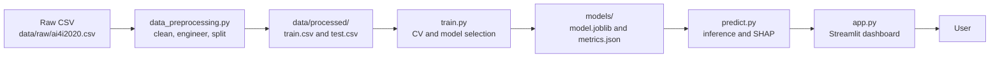
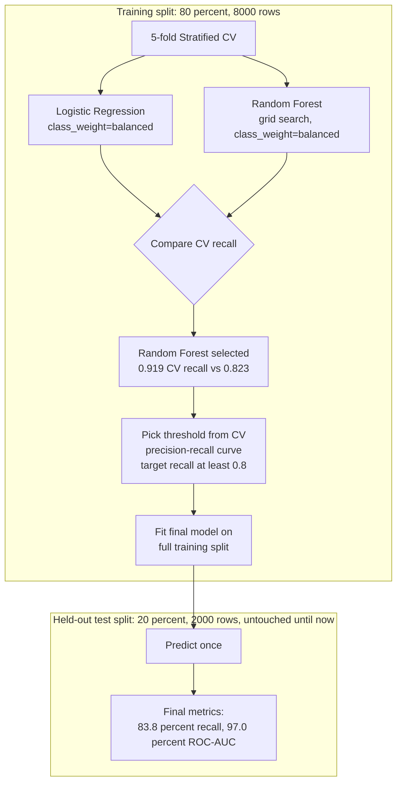
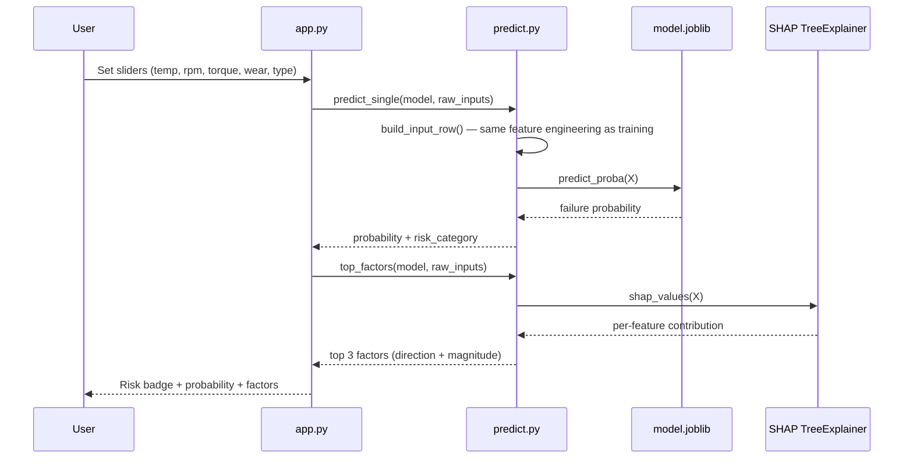

# Manufacturing Failure Prediction Dashboard


A portfolio data science project: an end-to-end machine learning pipeline and Streamlit
dashboard that predicts manufacturing machine failure from sensor/operating data, built
for a Junior Data Scientist application at Michelin.

**At a glance**

| | |
|---|---|
| **Dataset** | [AI4I 2020](https://archive.ics.uci.edu/dataset/601/ai4i+2020+predictive+maintenance+dataset) — 10,000 rows, 339 failures (3.39%) |
| **Problem** | Binary classification under heavy class imbalance |
| **Model** | Random Forest (`class_weight="balanced"`), chosen over Logistic Regression via cross-validation |
| **Test Recall / ROC-AUC** | **83.8%** / **97.0%** (held out, touched once) |
| **Explainability** | SHAP (global + per-prediction) |
| **Interface** | 5-page Streamlit dashboard |

## Table of Contents

- [Problem](#problem)
- [Business Context](#business-context)
- [Architecture](#architecture)
- [Project Structure](#project-structure)
- [Dataset](#dataset)
- [Approach](#approach)
- [Data Preparation](#data-preparation)
- [Exploratory Analysis](#exploratory-analysis)
- [Model Selection](#model-selection)
- [Model Performance](#model-performance)
- [Explainability](#explainability)
- [Demo](#demo)
- [Limitations](#limitations)
- [Future Improvements](#future-improvements)
- [How to Run](#how-to-run)

## Problem

Unplanned machine failure in a manufacturing line is costly: it halts production, risks
damaging equipment, and can be a safety issue. The goal here is to predict, from live
operating sensor readings, whether a machine is at risk of failure — so maintenance can be
prioritized before the failure happens rather than reacted to after.

## Business Context

In a predictive-maintenance setting, the question isn't "will this machine fail right now?"
in isolation — it's "which machines, out of many running in parallel, should get inspected
first?" A model that reliably flags high-risk machines lets a maintenance team spend limited
inspection time where it matters most, instead of on a fixed schedule or waiting for a machine
to actually break down.

## Architecture

The project is a one-way pipeline: raw data is cleaned and engineered once, a model is
trained and persisted once, and the dashboard only ever *reads* those persisted artifacts —
it never retrains. This keeps the app fast and keeps "what the model saw during training"
and "what the app predicts with" provably identical (the dashboard calls the exact same
`src/data_preprocessing.py` functions used at training time, so there is no train/serve skew).

**1. End-to-end data & model flow**



**2. Training methodology — how test-set leakage is avoided**

The threshold and the model itself are both chosen using only the training split; the test
set is touched exactly once, at the very end, purely to report final numbers.



**3. Live prediction — what happens when you click "Predict"**



## Project Structure

```
manufacturing-failure-prediction/
├── data/
│   ├── raw/ai4i2020.csv          # downloaded, untouched
│   └── processed/                 # output of data_preprocessing.py
│       ├── train.csv
│       └── test.csv
├── models/                        # output of train.py — loaded by app.py, never regenerated by it
│   ├── model.joblib
│   └── metrics.json
├── notebooks/
│   └── 01_eda.ipynb                # exploratory analysis behind the feature/model choices below
├── src/
│   ├── data_preprocessing.py       # load → clean → engineer features → split
│   ├── train.py                    # CV model selection → threshold → fit → persist
│   ├── predict.py                  # inference + SHAP explainability (shared by train.py and app.py)
│   └── evaluation.py               # metric/confusion-matrix/ROC helpers (shared by train.py and app.py)
├── tests/                          # unit tests for the three src/ modules above
├── app.py                          # Streamlit dashboard (5 pages)
├── requirements.txt
└── README.md
```

## Dataset

[AI4I 2020 Predictive Maintenance Dataset](https://archive.ics.uci.edu/dataset/601/ai4i+2020+predictive+maintenance+dataset)
(UCI Machine Learning Repository), 10,000 rows, one row per machine operating cycle.

| Column (raw) | Used as | Meaning |
|---|---|---|
| `Type` | `type_H`/`type_L`/`type_M` | Product quality variant (Low/Medium/High) |
| `Air temperature [K]` | `air_temp_k` | Ambient temperature around the machine |
| `Process temperature [K]` | `process_temp_k` | Temperature of the machine during operation |
| `Rotational speed [rpm]` | `rotational_speed_rpm` | Spindle rotational speed |
| `Torque [Nm]` | `torque_nm` | Torque applied during the operation |
| `Tool wear [min]` | `tool_wear_min` | Cumulative minutes the cutting tool has been in use |
| `Machine failure` | `machine_failure` (target) | 1 if any failure mode triggered, else 0 |

`UDI` and `Product ID` are dropped (pure identifiers). `TWF`, `HDF`, `PWF`, `OSF`, `RNF` are
dropped — they are *sub-flags for which failure mode occurred*, only knowable after the
failure has already happened, so training on them would leak the target.

The dataset is small and imbalanced: **339 failures out of 10,000 rows (3.39%)**.

## Approach

Binary classification under class imbalance. Two models are compared — **Logistic
Regression** (baseline) and **Random Forest** — both with `class_weight="balanced"`, selected
via 5-fold stratified cross-validation on the training split (not the test set), scored on
recall. The chosen model is fit once on the full training split, and evaluated exactly once
on a held-out test set. See [Architecture](#architecture) above for the full methodology flow.

**Primary metric: Recall** on the failure class. In this problem, a false negative (a real
failure the model misses) risks unplanned downtime; a false positive (a false alarm) only
costs an unnecessary inspection. Those costs are not symmetric, so accuracy alone is
misleading — predicting "no failure" for every machine would already score 96.6% accuracy
while catching zero real failures. Recall, precision, F1, and ROC-AUC are all reported
together so the tradeoff is visible rather than hidden behind one number.

## Data Preparation

1. Load the raw CSV, drop identifier and leakage columns, rename to snake_case.
2. Engineer two physics-grounded features:
   - `temp_diff_k` = `process_temp_k` − `air_temp_k` (heat generated under load)
   - `power_w` ≈ `torque_nm` × `rotational_speed_rpm` × (2π/60) (mechanical power — combines
     two raw sensors into one closer to the actual failure mechanism)
3. One-hot encode `type` into `type_H`/`type_L`/`type_M`.
4. Stratified 80/20 train/test split (stratified because the positive class is only 3.4% —
   a plain random split risks a test set with very few failures).

See `src/data_preprocessing.py`.

## Exploratory Analysis

See `notebooks/01_eda.ipynb`. Key findings: the failure rate is ~3.4% (confirming the need
for `class_weight="balanced"` rather than treating this as a balanced problem); `torque_nm`
and the engineered `power_w` show the strongest linear correlation with failure (≈0.19 and
≈0.18 respectively), consistent with overstrain/power-failure mechanics; `tool_wear_min` and
`rotational_speed_rpm` turn out to be the single strongest *model-learned* (SHAP) predictors,
showing the Random Forest is picking up non-linear interactions a simple correlation misses.

## Model Selection

| Model | CV Recall | CV Precision | CV F1 | CV ROC-AUC |
|---|---|---|---|---|
| Logistic Regression (`class_weight="balanced"`) | 0.823 | 0.164 | 0.274 | 0.919 |
| **Random Forest** (`class_weight="balanced"`, best params: `n_estimators=200`, `max_depth=5`) | **0.919** | 0.352 | 0.509 | 0.977 |

Random Forest is selected — it dominates Logistic Regression on every metric, not just
recall, which is expected given the non-linear interaction between torque/speed/wear that
drives failures in this dataset.

The decision threshold (0.615) is chosen from the cross-validated precision-recall curve to
target ≥80% recall on the training folds, **before** touching the test set — this avoids
tuning the threshold to the test data.

## Model Performance

Final Random Forest, evaluated once on the held-out test set (2,000 rows, 68 real failures):

| Metric | Value |
|---|---|
| Accuracy | 97.65% |
| Precision | 61.3% |
| **Recall** | **83.8%** |
| F1 | 70.8% |
| ROC-AUC | 97.0% |

Confusion matrix:

| | Predicted No Failure | Predicted Failure |
|---|---|---|
| **Actual No Failure** | 1,896 (TN) | 36 (FP) |
| **Actual Failure** | 11 (FN) | 57 (TP) |

Of 68 real failures, the model catches 57 and misses 11, at the cost of 36 false alarms out
of 1,932 non-failures (~1.9% false-alarm rate). That tradeoff — a small, cheap inspection cost
in exchange for catching 84% of real failures — is the kind of asymmetric cost predictive
maintenance is meant to exploit.

## Explainability

- **Global**: SHAP `TreeExplainer` on the Random Forest, averaged over a sample of the
  training set, surfaced on the dashboard's "Business Insights" page and stored in
  `models/metrics.json` under `global_importance`. Top drivers: `tool_wear_min`,
  `rotational_speed_rpm`, `power_w`, `torque_nm`.
- **Local**: the same SHAP explainer applied to a single input row, shown on the "Failure
  Prediction" page as the top 3 contributing factors for that specific prediction, with
  direction (increases/decreases risk). See the sequence diagram in
  [Architecture](#architecture) for exactly how this is wired.
- Fallback (if a Logistic Regression were ever selected instead): coefficient × input value
  as a linear per-feature contribution, and `|coefficient|` for global importance — no SHAP
  dependency needed for a linear model.

## Demo

Run locally (see **How to Run** below) and you'll see a 5-page dashboard: a headline Overview
with dataset size/failure rate/model metrics, a Data Analysis page with failure/feature
distributions and a correlation heatmap, a Model Performance page with the confusion matrix
and ROC curve, an interactive Failure Prediction page (enter sensor values, get a
probability + LOW/MEDIUM/HIGH risk badge + top contributing factors), and a Business Insights
page summarizing what the model found and its practical use case.

## Limitations

- **Synthetic-but-realistic dataset**: AI4I 2020 is designed to mimic real industrial failure
  mechanics, but it is not live plant data — real sensor noise, drift, and failure modes not
  represented in this dataset could behave differently.
- **Class imbalance**: only 339 failures to learn from; rare failure subtypes may be
  under-represented even within that small positive class.
- **False positive / false negative asymmetry**: the model is tuned to favor recall, which
  means it will generate more false alarms than a precision-tuned model would — this is a
  deliberate tradeoff, not a flaw, but it has a real operational cost (unnecessary
  inspections) that a deployment would need to size against the cost of a missed failure.
- **No real-time streaming data**: this is a static, point-in-time model over a fixed
  snapshot of sensor readings, not a system that monitors a live data stream or detects
  drift over time.
- **Generalization**: trained and evaluated on one dataset from one (synthetic) manufacturing
  context — performance on a different machine type, sensor suite, or real factory floor is
  unverified.

**This project is a portfolio MVP, not a production-ready system.** A real deployment would
need real plant data validation, monitoring for data/model drift, a human-in-the-loop review
process, and infrastructure well beyond this repo's scope.

## Future Improvements

- Try SMOTE or other oversampling alongside `class_weight="balanced"` and compare.
- Add XGBoost as a third model comparison point.
- Calibrate predicted probabilities (e.g. `CalibratedClassifierCV`) if probability values
  themselves (not just rank-ordering) need to be trustworthy.
- Track model performance over time / retraining if deployed against a live data feed.

## How to Run

```bash
cd manufacturing-failure-prediction
python3 -m venv venv
source venv/bin/activate
pip install -r requirements.txt

# Artifacts (models/model.joblib, models/metrics.json) are already committed —
# to retrain from scratch instead:
python -m src.data_preprocessing
python -m src.train

# Run the test suite:
python -m pytest tests/ -v

# Launch the dashboard:
streamlit run app.py
```
